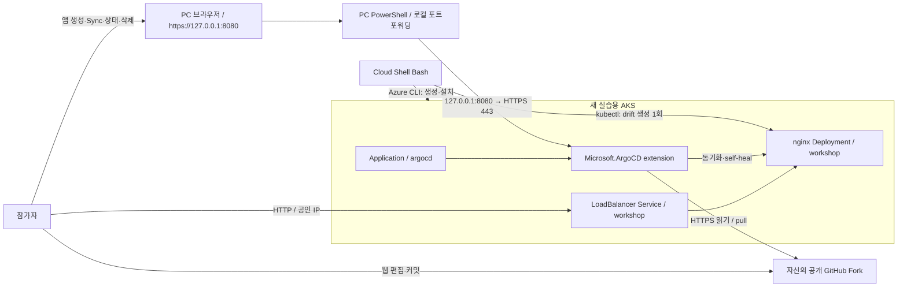
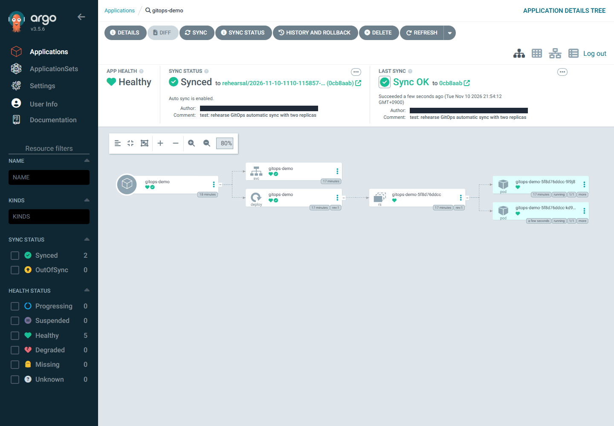

# 처음 시작하는 AKS GitOps: Argo CD extension 워크숍

> Kubernetes는 알지만 Azure는 처음인 참가자를 위한 한국어 핸즈온입니다. **전체 목표 시간 90분** 동안 새 AKS에 Microsoft.ArgoCD extension을 설치하고, Argo CD UI로 nginx를 배포합니다. Git 변경의 자동 반영과 수동 변경의 자동 복구를 확인한 뒤 안전하게 정리합니다.

**처음이라면 [01. 실습 준비](docs/01-prerequisites.md)부터 시작하세요.** 로컬 Azure CLI·kubectl 설치는 실습 전에 준비합니다. 이미지 빌드·GitHub 쓰기 토큰은 필요하지 않습니다.

> **검증 상태:** 2026-11-10 실제 AKS에서 extension 설치, 로컬 Argo CD UI 로그인·앱 생성·첫 Sync·자동 정책·Git 변경 반영·Self Heal·foreground 앱 삭제와 **Azure 전용 그룹·관리 노드 그룹 삭제 완료**를 검증했습니다. 실제 화면과 환경·대체 단계는 아래 [검증 기록](#검증-기록)을 확인하세요. **참가자 기준 90분 완료를 실측한 것은 아닙니다.**
>
> **원본 저장소:** [freeman9844/aks-argo-test-01](https://github.com/freeman9844/aks-argo-test-01). 형식 참고용 Landing Zone·Application Routing 저장소는 Fork 대상이 아닙니다.
>
> **공개 저장소:** 2026-11-10 배포자 승인으로 원본을 **공개 전환**했고 익명 Git 읽기를 확인했습니다. 참가자는 공개 저장소를 Fork할 수 있는 **개인 GitHub 계정**을 준비하세요. Enterprise Managed User(EMU)는 기업 외부 공개 저장소의 Fork·기여가 제한될 수 있습니다.

## 실습을 진행하는 방법

각 단계는 **👁️ 설명 → 🟢 실행 → 📋 확인** 순서로 읽습니다. 먼저 목적을 이해하고, 표시된 환경에서 한 단계씩 실행한 뒤 실제 결과를 확인합니다. 비용·비밀번호·삭제·실패 복구 조건은 **⚠️ 주의**로 구분합니다.

| 실행 위치 | 수행할 작업 |
|---|---|
| Cloud Shell **Bash** | Azure 리소스 생성·extension 설치·drift 생성 1회·Azure 정리 |
| 참가자 PC의 **Windows PowerShell** | AKS 연결·로컬 포트포워딩·초기 비밀번호 취득 |
| PC 브라우저의 **Argo CD UI** | 로그인·앱 생성·첫 Sync·자동 정책·상태 확인·앱 삭제 |
| **GitHub 웹** | 자신의 공개 Fork에서 replicas 수정·커밋 |

코드 블록은 실행 위치를 확인한 뒤 하나씩 입력합니다. UI 단계는 브라우저에서 수행하며, **예상 출력·구조 예시·참고 YAML은 터미널에 입력하지 않습니다.** 오류가 나면 다음 단계로 넘어가지 말고 해당 모듈의 트러블슈팅을 확인합니다. 중간에 그만두더라도 마지막 정리는 반드시 진행합니다.

처음 보는 Bash 문법은 [실행 블록 읽는 법](docs/01-prerequisites.md#실행-블록-읽는-법)을 먼저 확인하세요. Cloud Shell과 PC는 변수·로그인·kubeconfig를 공유하지 않습니다.

## 무엇을 배우나요?

1. Cloud Shell에서 구독·권한을 확인하고 실습 전용 리소스 그룹·AKS를 생성합니다.
2. Helm 직접 설치 대신 Azure 클러스터 extension으로 Argo CD를 설치하고 로컬 UI에 로그인합니다.
3. UI에서 자신의 Git 저장소를 읽는 Application을 만들고 첫 수동 Sync와 앱 HTTP 응답을 확인합니다.
4. 자동 Sync·Prune·Self Heal을 켜고 Git replicas 1 → 2 변경과 커밋 SHA·동기화·Pod 상태를 UI에서 비교합니다.
5. 수동으로 replicas를 3으로 바꾼 뒤 Git의 값 2로 복귀하는 self-heal을 관찰합니다.
6. UI에서 앱과 자식 리소스를 삭제한 뒤 Azure 실습 그룹과 관리 노드 그룹의 삭제 완료를 확인합니다.

**모듈 01–06을 순서대로 진행하는 하나의 과정**입니다. 설치 이후의 앱 작업은 UI를 중심으로 진행하며, Azure 리소스 정리까지 포함합니다.

## 구성 개요: GitOps와 로컬 관리 화면

👁️ **설명**

아래는 앱 배포 후의 구성입니다. 그림은 구조 설명이며 실행 명령이 아닙니다.

Git이 원하는 상태의 기준입니다. GitHub에서 AKS로 push하는 CI 파이프라인이 아닙니다. Application은 UI에서 만들고, 실제 앱 Deployment·Service는 Argo CD가 Git에서 읽어 생성합니다. 첫 Manual Sync 후 자동 Sync로 전환합니다. `manifests/argocd/application.yaml`은 자동 정책 적용 후의 참고 상태이며 별도로 적용하지 않습니다.

관리 화면은 **로컬 HTTPS**로만 접속하며 공개 endpoint를 만들지 않습니다. Cloud Shell의 localhost와 PC의 localhost는 다릅니다. PC의 포워딩 창은 앱 삭제까지 유지하고, 공개되는 **HTTP nginx 앱**과 구분합니다.

## 사전 요구사항

| 항목 | 준비 |
|---|---|
| Kubernetes | Deployment·Service·namespace·kubectl 기본 이해 |
| Azure | 유료 리소스를 만들고 삭제할 수 있는 실습용 구독 |
| 권한 | 리소스 그룹·AKS 생성/삭제, extension 관리, Kubernetes 접근. 세부는 [01](docs/01-prerequisites.md) |
| 공급자 | Microsoft.ContainerService·Microsoft.Kubernetes·Microsoft.KubernetesConfiguration 등록 |
| GitHub | 공개 Fork 생성·웹 편집이 가능한 자신의 계정 |
| 터미널 | Azure 작업용 Cloud Shell **Bash**와 참가자 PC의 **Windows PowerShell** |
| 로컬 도구 | Windows용 Azure CLI·kubectl을 실습 전에 설치. 공식 링크·확인은 01 |
| 네트워크 | 공개 AKS API와 GitHub·이미지 레지스트리·Azure 관리 엔드포인트로 송신 가능 |
| 지역·쿼터 | 기본 Korea Central, Standard_D2s_v5 2개를 생성할 용량·vCPU 쿼터 |

기존 운영 클러스터·사설망 전용 환경은 사용하지 않습니다. Argo CD UI 로그인·초기 비밀번호 변경은 포함하지만 관리 화면 외부 공개·도메인·인증서 발급·Entra SSO·ACR·비공개 Git·ApplicationSet·CI는 범위 밖입니다.

## 모듈 목차

| # | 모듈 | 완료하면 할 수 있는 일 | 목표 시간 |
|---|---|---|---:|
| 01 | [실습 준비](docs/01-prerequisites.md) | 구독·권한·공급자·Fork를 확인하고 변수를 복원 | 10분 |
| 02 | [AKS 환경 준비](docs/02-environment-setup.md) | 전용 리소스 그룹·AKS를 만들고 노드 Ready 확인 | 20분 |
| 03 | [extension 설치·UI 접속](docs/03-install-argocd-extension.md) | 비HA 설치·PC 포워딩·로그인·초기 비밀번호 변경 | 15분 |
| 04 | [UI 앱 배포](docs/04-deploy-sample-app.md) | NEW APP·첫 수동 Sync·리소스 트리·HTTP 확인 | 15분 |
| 05 | [Git 변경·자동 복구](docs/05-gitops-update-self-heal.md) | 자동 정책을 켜고 Git SHA·Ready·Self Heal 비교 | 20분 |
| 06 | [정리](docs/06-cleanup.md) | UI cascading 삭제와 Azure 두 그룹의 삭제 완료 확인 | 10분 |
| | **전체 합계** | 생성·삭제 대기를 포함한 설계 목표, 실측 아님 | **90분** |

로컬 Azure CLI·kubectl 설치와 공급자 등록·권한 부여는 행사 전에 완료합니다. 설치 시간은 위 90분에 포함하지 않습니다. SKU 용량·송신 제한·프로비저닝 지연에 따라 더 걸릴 수 있습니다.

## 비용과 정리

| 리소스 | 실습 구성·과금 요소 |
|---|---|
| AKS 노드 VM | Standard_D2s_v5 × 2, 실행 시간에 따라 과금 |
| 노드 디스크 | AKS가 생성하는 OS 디스크 등 |
| Standard Load Balancer·공개 IP | AKS 기본 네트워크와 샘플 Service 구성에 따라 과금 |
| 네트워크 | 아웃바운드 전송량·기타 실제 사용량 |
| Cloud Shell 스토리지 | 영구 홈 저장소를 선택했다면 별도 리소스·비용이 있을 수 있음 |

⚠️ **주의**

AKS **Free 요금제는 인프라 전체 무료가 아닙니다**. 2026-11-10 리허설 전 Azure Retail 가격 조회에서 Korea Central Linux `Standard_D2s_v5`는 대당 **USD 0.118/시간**, 2대 합계 **USD 0.236/시간**이었습니다. 디스크·Load Balancer·IP·네트워크·세금은 별도이며 실제 청구액이나 고정 비용을 보장하지 않습니다. 실습 직전 [Azure Pricing Calculator](https://azure.microsoft.com/pricing/calculator/)에서 다시 산정하세요.

워크숍 그룹에는 `workload=aks-argocd-workshop`, `environment=workshop` 태그를 붙입니다. `MC_...` 노드 그룹은 AKS가 관리하므로 직접 먼저 삭제하지 않습니다.

공개 HTTP 앱에는 비밀·개인정보를 넣지 않습니다. 학습용 비HA·공개 API·기본 사용자 자격 증명 구성은 운영 권장 구성이 아닙니다. **완료·실패 여부와 관계없이 [06. 정리](docs/06-cleanup.md)를 진행하세요.** 삭제 명령 성공과 삭제 완료는 다릅니다.

Cloud Shell 저장소처럼 워크숍 그룹 외부의 공유 리소스는 자동으로 삭제하지 않습니다. 따로 만든 경우 소유 범위·다른 사용 여부를 확인한 후 정리합니다.

## 세션이 끊겼을 때

Cloud Shell의 변수는 새 세션에 남지 않습니다. [변수 복원](docs/01-prerequisites.md#5-새-세션에서-재개하는-경우)으로 `$HOME/.aks-argocd-ws-env`를 읽고 **기존 실습의 이름**을 사용합니다. 파일이 없다면 같은 절의 복구 안내를 따르며 새 이름을 만들지 않습니다. 환경 파일·kubeconfig·비밀번호는 Git에 올리지 않습니다.

PC의 포워딩이 끊겼다면 [03의 로컬 접속](docs/03-install-argocd-extension.md) 절차로 다시 연결합니다. Cloud Shell과 PC의 localhost는 서로 다릅니다. 이미 생성된 자원은 상태를 확인한 후 이어서 진행하고, 실패한 생성 명령을 무작정 반복하지 않습니다.

## 태깅 범례와 트러블슈팅

| 표시 | 읽는 방법 |
|---|---|
| 👁️ **설명** | 작업의 목적과 리소스 관계를 먼저 이해합니다. |
| 🟢 **실행** | 표시된 터미널에서 명령을 입력하거나 브라우저에서 UI 단계를 수행합니다. |
| 📋 **확인** | 실제 이름·값·상태를 완료 기준과 비교합니다. 출력 예시를 실행하지 않습니다. |
| ⚠️ **주의** | 보안·비용·삭제·재개 조건을 확인한 뒤 진행합니다. |

표시는 본문과 분리된 줄로 배치합니다. 출력 예시와 스크린샷은 비교 자료이며 자신의 실제 결과를 대신하지 않습니다. 각 모듈 끝의 **완료 체크**를 확인하고 다음 모듈로 이동합니다.

| 증상 | 이동 |
|---|---|
| 권한·공급자·Fork·환경 파일 | [실습 준비](docs/01-prerequisites.md#트러블슈팅) |
| SKU·쿼터·AKS·노드 Ready | [AKS 환경 준비](docs/02-environment-setup.md#트러블슈팅) |
| extension·로컬 포워딩·로그인 | [extension 설치·UI 접속](docs/03-install-argocd-extension.md#트러블슈팅) |
| 첫 Sync·Pod·Service IP·HTTP | [UI 앱 배포](docs/04-deploy-sample-app.md#트러블슈팅) |
| 새 SHA·자동 동기화·Self Heal | [Git 변경·자동 복구](docs/05-gitops-update-self-heal.md#트러블슈팅) |
| 중도 실패·앱 삭제·Azure 삭제 지연 | [정리](docs/06-cleanup.md#트러블슈팅) |

## 검증 기록

| 구분 | 결과 |
|---|---|
| 검증일·지역 | 2026-11-10 / Korea Central |
| 문서 상대 링크·모듈 연결 | 확인 |
| 실행 Bash 블록 | Git for Windows Bash로 `bash -n` 확인 |
| 로컬 PowerShell 블록 | PowerShell Parser로 구문 확인. 실제 리허설은 전용 kubeconfig와 명시적 구독 옵션을 사용한 로컬 PowerShell에서 실행 |
| 로컬 CLI 사전 점검 | 문서의 `az version` 명령을 Windows PowerShell 5.1에서 실제 실행 확인. 클라우드 리소스 작업과 별개 |
| 매니페스트 3개 | PyYAML 6.0.3 파싱 확인 |
| Application 참고 YAML | 문법 파싱 확인. 기본 UI 흐름에서 렌더링·CLI 적용하지 않음 |
| 문서 실행 블록 회귀 검사 | 빈 Fork 입력 차단·기존 이름 복구·kubeconfig 재취득 3개 테스트 통과. 외부 Azure 호출은 대역 사용 |
| AKS | Kubernetes **1.36.5**, Base SKU·Free tier, Azure CNI Overlay, `Standard_D2s_v5` 2개 Ready |
| 설치 도구 | Azure CLI **2.91.0**, `k8s-extension` **1.9.5**, kubectl **1.36.5** |
| extension·Argo CD | Stable **1.0.20**, `redis-ha.enabled=false`, 서버 이미지 `mcr.microsoft.com/oss/v2/argoproj/argocd:v3.5.6-3` |
| UI 실행 방식 | 별도 Computer Use 도구 대신 승인된 **Playwright + Edge 157.0.4341.42** 실제 브라우저 조작. 로컬 HTTPS만 사용 |
| 초기 계정 | UI 비밀번호 변경·새 비밀번호 재로그인·초기 Secret 삭제 확인 |
| 첫 배포 | UI NEW APP, Manual·CreateNamespace, namespace 미존재 → UI 첫 Sync → Synced·Healthy, replicas·Ready 1 |
| nginx 이미지·HTTP | `nginx:1.28.3` 실제 pull·실행. UI Service IP 조회 후 PowerShell HTTP 클라이언트로 **200과 nginx 본문** 확인 |
| Git 자동 반영 | UI에서 Automated Sync·Prune·Self Heal 활성화. Git replicas 1 → 2를 **수동 Sync 없이** 반영, 새 SHA·replicas·Ready 2·Ready Pod 2개 확인 |
| Self Heal | CLI scale 3을 **1회** 실행해 실제 3 관측 → UI live replicas·Ready 2 복귀. 동일 Git SHA 유지·추가 커밋·수동 Sync 없음 |
| UI 앱 정리 | Foreground 삭제 후 UI 목록에서 앱 사라짐, Application·Deployment·Service·Pod 부재 확인 |
| Azure 정리 | 전용 namespace·extension 삭제, 실습 그룹·관리 노드 그룹 모두 `az group exists=false` 확인. 포워딩 종료·전용 kubeconfig·암호·브라우저 쿠키·SSH 키 제거 |

### 검증 범위와 대체 단계

- **GitHub:** EMU 계정의 공개 Fork가 403으로 차단돼, 승인 후 원본의 격리된 `rehearsal/2026-11-10-1110-115857-9176` 브랜치와 `gh` 커밋으로 대체했습니다. [실제 replicas 2 커밋](https://github.com/freeman9844/aks-argo-test-01/commit/0cb8aab5366a088a6ca1ac75da53d486ae3e236f)을 UI revision과 비교했습니다. **Fork 생성·GitHub 웹 편집은 미검증**이며, `main`의 초기 replicas는 1을 유지합니다.
- **터미널:** Azure·kubectl 작업은 로컬 PowerShell에서 수행했습니다. Cloud Shell 로그인·Bash 실행 환경, 문서의 대화형 입력·클립보드 동작까지 실행한 것은 아닙니다. Bash 블록은 별도 구문·회귀 검사로 확인합니다.
- **공개 HTTP 브라우저:** Edge가 공개 IP의 HTTP 탐색을 `net::ERR_BLOCKED_BY_CLIENT`로 차단했습니다. 원인을 보안 정책으로 단정하거나 설정을 해제하지 않았습니다. HTTP 200은 PowerShell로 검증했으며 **브라우저의 nginx 페이지는 미검증**입니다. Argo CD 로컬 UI 조작은 정상 수행했습니다.
- **Prune:** 활성화·저장된 정책은 확인했습니다. Git 파일 삭제에 따른 자동 Prune 실험은 하지 않았고, 마지막 자식 리소스 정리는 UI foreground cascading 삭제로 검증했습니다.

스크린샷은 실제 리허설 화면이며 연락처를 가렸습니다. 화면의 저장소·전용 브랜치는 검증용입니다. **참가자는 이미지 속 브랜치를 복사하지 말고 자신의 공개 Fork·실제 브랜치를 입력**합니다. 화면 왼쪽 필터의 `Healthy`·`Synced` 건수가 아니라 상단 **APP HEALTH·SYNC STATUS**와 실제 리소스의 Ready 상태를 확인합니다.

### 실측 시간

AKS 생성·자격 증명 취득은 **4분 18초**, extension 설치는 **6분 23초**였습니다. Self Heal은 scale 실행부터 UI 최종 확인까지 약 **6초**, UI foreground 삭제부터 앱·자식 부재 확인까지 약 **22초**, namespace·extension·Azure 두 그룹 정리는 **10분 36초**였습니다.

준비 시작부터 Azure 삭제 완료까지 **약 71분 27초**(11:58:57~13:10:24 UTC)가 걸렸습니다. 도구 준비·브라우저 자동화 작성·오류 진단이 포함된 단일 리허설이며, 미검증 대체 단계도 있으므로 참가자의 전체 실습 소요 시간을 증명하지 않습니다. 위의 90분은 참가자용 설계 목표입니다.

기여자는 저장소 루트에서 `python -m unittest discover -s tests -p 'test_*.py' -v`로 회귀 검사를 실행합니다. Python 표준 라이브러리와 실제 Bash가 필요하며 Azure 리소스는 생성하지 않습니다. Bash를 자동 탐색하지 못하면 `BASH_PATH` 환경 변수에 실행 파일 경로를 지정합니다.

## 참고 자료

- [교재 진행 형식 참고](https://github.com/freeman9844/ms-landing-zone-02)
- [최초 기획 참고 워크숍](https://github.com/freeman9844/ms-aks-approuting-workshop01)
- [AKS Argo CD extension GA 발표](https://techcommunity.microsoft.com/blog/azurearcblog/gitops-with-argo-cd-extension-for-aks-is-now-generally-available/4562231)
- [공식 설치·배포 튜토리얼](https://learn.microsoft.com/azure/azure-arc/kubernetes/tutorial-use-gitops-argocd)
- [Argo CD extension 개념](https://learn.microsoft.com/azure/azure-arc/kubernetes/conceptual-gitops-argocd)
- [Argo CD UI 앱 생성·Sync](https://argo-cd.readthedocs.io/en/stable/getting_started/#creating-apps-via-ui)
- [Argo CD 자동 동기화·self-heal](https://argo-cd.readthedocs.io/en/stable/user-guide/auto_sync/)
- [Argo CD cascading deletion](https://argo-cd.readthedocs.io/en/stable/user-guide/app_deletion/)

2026-11-10 확인 기준, **AKS는 GA**, Azure Arc-enabled Kubernetes는 preview입니다. 일부 포털·개념 문서의 preview 표기를 AKS의 현재 제공 상태와 혼동하지 않습니다.
