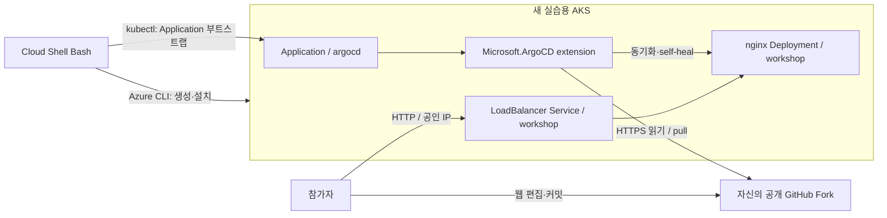

# AKS Argo CD extension GitOps 핸즈온 워크샵

Kubernetes는 알지만 Azure는 처음인 사용자를 위한 **약 90분** 실습입니다. 새 AKS에 **Microsoft.ArgoCD extension**을 설치하고, 자신의 공개 GitHub Fork에서 nginx 샘플 앱을 배포합니다. GitHub 웹 편집으로 replicas를 바꾸고 자동 동기화·수동 변경 자동 복구를 확인합니다.

Azure 작업은 **Azure Cloud Shell(bash)**, Git 변경은 **GitHub 웹 화면**에서 수행합니다. 로컬 설치·이미지 빌드·GitHub 쓰기 토큰 없이 진행합니다.

> **검증 상태:** 문서·YAML·Bash 문법의 정적 검증만 수행했습니다. 실제 Azure 배포, extension 버전별 호환성, 자동 복구, 삭제 완료 및 90분 소요 시간은 **아직 리허설하지 않았습니다**. 유료 리허설은 별도 승인 후 수행합니다.
>
> **원본 저장소:** [freeman9844/aks-argo-test-01](https://github.com/freeman9844/aks-argo-test-01). 아래 참고용 Application Routing 저장소가 Fork 대상은 아닙니다.
>
> **공개 여부 주의:** 2026-11-10 동기화 시점에는 원본 저장소가 **비공개**입니다. 현재 실습은 공개 Fork와 익명 Git 읽기가 필요하므로 이 상태로는 그대로 진행할 수 없습니다. 배포자가 별도로 공개 전환을 승인·완료한 뒤 참가자에게 안내하세요. 동기화 과정에서 공개 여부는 변경하지 않습니다.

## 학습 목표

1. Cloud Shell에서 구독·권한을 확인하고 실습 전용 리소스 그룹·AKS를 생성합니다.
2. Helm 직접 설치 대신 Azure 클러스터 extension으로 Argo CD를 설치합니다.
3. 자신의 Git 저장소를 읽는 Application을 생성하고 앱의 HTTP 응답을 확인합니다.
4. Git replicas 1 → 2 변경과 실제 커밋 SHA·동기화·Pod 상태를 비교합니다.
5. 수동으로 replicas를 3으로 바꾼 뒤 Git의 값 2로 복귀하는 self-heal을 관찰합니다.
6. 실습 그룹과 관리 노드 그룹의 삭제 완료를 확인합니다.

## 아키텍처

**개념 — 실행할 명령이 아닙니다**

Git이 원하는 상태의 기준입니다. GitHub에서 AKS로 push하는 CI 파이프라인이 아닙니다. Application은 부트스트랩 명령으로 만들고, 실제 앱 Deployment·Service는 Argo CD가 Git에서 읽어 생성합니다.

## 사전 요구사항

| 항목 | 준비 |
|---|---|
| Kubernetes | Deployment·Service·namespace·kubectl 기본 이해 |
| Azure | 유료 리소스를 만들고 삭제할 수 있는 실습용 구독 |
| 권한 | 리소스 그룹·AKS 생성/삭제, extension 관리, Kubernetes 접근. 세부는 [01](docs/01-prerequisites.md) |
| 공급자 | Microsoft.ContainerService·Microsoft.Kubernetes·Microsoft.KubernetesConfiguration 등록 |
| GitHub | 공개 Fork 생성·웹 편집이 가능한 자신의 계정 |
| 터미널 | Cloud Shell **Bash**, 최신 도구 확인은 01에서 수행 |
| 네트워크 | 공개 AKS API와 GitHub·이미지 레지스트리·Azure 관리 엔드포인트로 송신 가능 |
| 지역·쿼터 | 기본 Korea Central, Standard_D2s_v5 2개를 생성할 용량·vCPU 쿼터 |

기존 운영 클러스터·사설망 전용 환경은 사용하지 않습니다. Argo CD UI 공개·로그인, DNS·TLS·Entra SSO·ACR·비공개 Git·ApplicationSet·CI는 범위 밖입니다.

## 모듈과 시간표

| 모듈 | 내용 | 목표 시간 |
|---|---|---|
| [01 — 사전 준비](docs/01-prerequisites.md) | Cloud Shell·구독·권한·공급자·Fork·변수 | 10분 |
| [02 — 환경 준비](docs/02-environment-setup.md) | 전용 리소스 그룹·AKS·kubectl 연결 | 20분 |
| [03 — extension 설치](docs/03-install-argocd-extension.md) | 비HA Argo CD 설치·구성요소 준비 확인 | 15분 |
| [04 — 앱 배포](docs/04-deploy-sample-app.md) | Application 생성·최초 동기화·HTTP 확인 | 15분 |
| [05 — Git 변경·자동 복구](docs/05-gitops-update-self-heal.md) | replicas 변경·revision 확인·self-heal | 20분 |
| [06 — 정리](docs/06-cleanup.md) | 앱·extension·리소스 그룹 삭제와 완료 확인 | 10분 |
| **합계** | 생성·삭제 대기를 포함한 설계 목표, 실측 아님 | **90분** |

공급자 등록·권한 부여는 행사 전에 완료하는 것을 권장합니다. SKU 용량·송신 제한·프로비저닝 지연에 따라 더 걸릴 수 있습니다.

각 모듈의 **실행** 블록만 복사합니다. **개념**·**예상 출력**은 입력하지 않습니다. 새 세션에서는 [변수 복원](docs/01-prerequisites.md#5-새-세션에서-재개하는-경우) 후 작업 대상을 재확인합니다.

## 비용과 안전

| 리소스 | 실습 구성·과금 요소 |
|---|---|
| AKS 노드 VM | Standard_D2s_v5 × 2, 실행 시간에 따라 과금 |
| 노드 디스크 | AKS가 생성하는 OS 디스크 등 |
| Standard Load Balancer·공개 IP | AKS 기본 네트워크와 샘플 Service 구성에 따라 과금 |
| 네트워크 | 아웃바운드 전송량·기타 실제 사용량 |
| Cloud Shell 스토리지 | 영구 홈 저장소를 선택했다면 별도 리소스·비용이 있을 수 있음 |

AKS **Free 요금제는 인프라 전체 무료가 아닙니다**. 실습 직전 [Azure Pricing Calculator](https://azure.microsoft.com/pricing/calculator/)에서 리전·VM 2개·디스크·네트워크와 예상 실행 시간을 지정해 산정하세요. 단가는 확인하지 않았으며 고정 비용을 보장하지 않습니다.

워크샵 그룹에는 `workload=aks-argocd-workshop`, `environment=workshop` 태그를 붙입니다. `MC_...` 노드 그룹은 AKS가 관리하므로 직접 먼저 삭제하지 않습니다.

공개 HTTP 앱에는 비밀·개인정보를 넣지 않습니다. 학습용 비HA·공개 API·기본 사용자 자격 증명 구성은 운영 권장 구성이 아닙니다. 실습을 중단해도 반드시 **06 — 정리**를 진행하세요. 삭제 명령 성공과 삭제 완료는 다릅니다.

Cloud Shell 저장소처럼 워크샵 그룹 외부의 공유 리소스는 자동으로 삭제하지 않습니다. 따로 만든 경우 소유 범위·다른 사용 여부를 확인한 후 정리합니다.

## 검증 기록

| 구분 | 결과 |
|---|---|
| 정적 검증일 | 2026-11-10 |
| 문서 상대 링크·모듈 연결 | 확인 |
| 실행 Bash 블록 | Git for Windows Bash로 `bash -n` 확인 |
| 매니페스트 3개 | PyYAML 6.0.3 파싱 확인 |
| Application 템플릿 | 문서의 Python 렌더러로 URL·따옴표 포함 브랜치 치환 확인 |
| 문서 실행 블록 회귀 검사 | 빈 Fork 입력 차단·기존 이름 복구·kubeconfig 재취득 3개 테스트 통과. 외부 Azure 호출은 대역 사용 |
| nginx 이미지 | Docker Hub에서 `nginx:1.28.3` 태그 존재 확인. 실제 pull·실행 미검증 |
| Azure·Kubernetes 실제 실행 | **미실시** — 검증된 CLI/extension/AKS 버전·소요 시간 없음 |

정적 검사는 API schema 호환성·실제 extension 설치·네트워크 접근·동기화·삭제를 증명하지 않습니다. 리허설 후 실제 버전·지역·소요 시간·변경 사항을 이 표에 기록합니다.

기여자는 저장소 루트에서 `python -m unittest discover -s tests -p 'test_*.py' -v`로 회귀 검사를 실행합니다. Python 표준 라이브러리와 실제 Bash가 필요하며 Azure 리소스는 생성하지 않습니다. Bash를 자동 탐색하지 못하면 `BASH_PATH` 환경 변수에 실행 파일 경로를 지정합니다.

## 참고 자료

- [참고 워크샵의 문서 형식](https://github.com/freeman9844/ms-aks-approuting-workshop01)
- [AKS Argo CD extension GA 발표](https://techcommunity.microsoft.com/blog/azurearcblog/gitops-with-argo-cd-extension-for-aks-is-now-generally-available/4562231)
- [공식 설치·배포 튜토리얼](https://learn.microsoft.com/azure/azure-arc/kubernetes/tutorial-use-gitops-argocd)
- [Argo CD extension 개념](https://learn.microsoft.com/azure/azure-arc/kubernetes/conceptual-gitops-argocd)
- [Argo CD 자동 동기화·self-heal](https://argo-cd.readthedocs.io/en/stable/user-guide/auto_sync/)
- [Argo CD cascading deletion](https://argo-cd.readthedocs.io/en/stable/user-guide/app_deletion/)

2026-11-10 확인 기준, **AKS는 GA**, Azure Arc-enabled Kubernetes는 preview입니다. 일부 포털·개념 문서의 preview 표기를 AKS의 현재 제공 상태와 혼동하지 않습니다.
