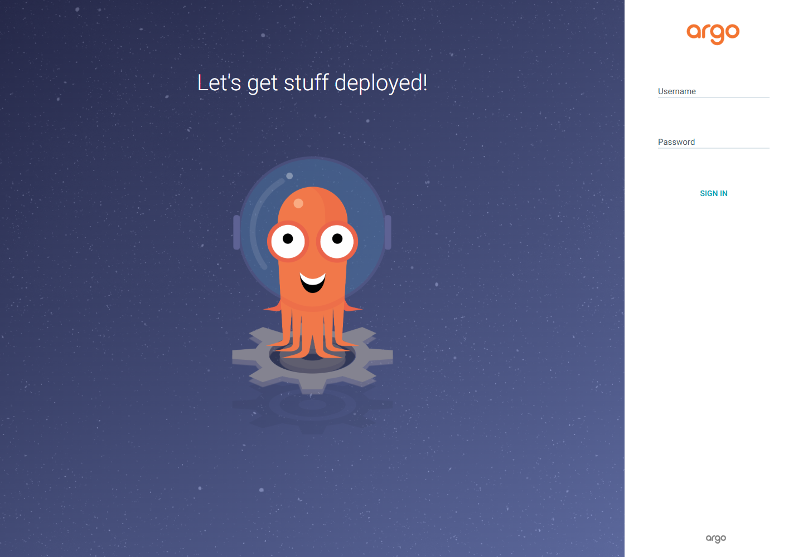

# 03 — Argo CD extension 설치와 로컬 UI 접속

> **실행**: 직접 입력합니다. **개념**: 읽기만 합니다. **예상 출력**: 비교용입니다.

예상 소요 시간: 15분 목표. 설치·로그인 대기가 길면 더 걸릴 수 있습니다. 로컬 도구 설치는 사전 준비입니다.

## 성공 조건

Azure extension이 `Succeeded`, Argo CD Deployment·StatefulSet이 준비 완료입니다. 참가자 PC의 로컬 HTTPS로 UI에 로그인하고 초기 비밀번호를 변경합니다. 관리 화면은 외부에 공개하지 않습니다.

## 0. 작업 대상 복원

**실행**
```bash
set -euo pipefail
source "$HOME/.aks-argocd-ws-env"
az account set --subscription "$SUBSCRIPTION_ID"
kubectl config use-context "$CLUSTER"
az aks show -g "$RESOURCE_GROUP" -n "$CLUSTER" --query '{State:provisioningState,Identity:identity.type}' -o table
kubectl get nodes
```

관리 ID 기반 AKS가 필요합니다. 앞 모듈의 새 클러스터를 사용하며, 기존 운영 클러스터에 적용하지 않습니다.

## 1. Azure CLI extension 준비

`Microsoft.ArgoCD`는 AKS에 설치되는 **클러스터 extension**, `k8s-extension`은 이를 관리하는 **Azure CLI 확장 패키지**입니다.

**실행**
```bash
installed_extensions="$(az extension list --query '[].name' -o tsv)"
if grep -Fxq k8s-extension <<< "$installed_extensions"; then
  az extension update --name k8s-extension
else
  az extension add --name k8s-extension
fi
az extension show --name k8s-extension --query '{Name:name,Version:version}' -o table
```

## 2. 비HA 설치

[공식 튜토리얼](https://learn.microsoft.com/azure/azure-arc/kubernetes/tutorial-use-gitops-argocd)에 따르면 기본 Redis HA 구성은 노드 4개가 필요합니다. 이 실습은 비용·구성을 줄이기 위해 `redis-ha.enabled=false`를 명시합니다. 운영 환경에서는 별도의 HA·용량·보안 설계가 필요합니다.

**실행**
```bash
az k8s-extension create --resource-group "$RESOURCE_GROUP" \
  --cluster-name "$CLUSTER" --cluster-type managedClusters \
  --name "$EXTENSION_NAME" --extension-type Microsoft.ArgoCD \
  --scope cluster --release-namespace argocd \
  --config "redis-ha.enabled=false"
az k8s-extension show --resource-group "$RESOURCE_GROUP" \
  --cluster-name "$CLUSTER" --cluster-type managedClusters --name "$EXTENSION_NAME" \
  --query '{State:provisioningState,Type:extensionType,Version:currentVersion}' -o table
test "$(az k8s-extension show -g "$RESOURCE_GROUP" --cluster-name "$CLUSTER" \
  --cluster-type managedClusters -n "$EXTENSION_NAME" --query provisioningState -o tsv)" = Succeeded
```

GA용 기본 release train을 사용합니다. 출력된 실제 extension 버전을 기록하세요. 실행 중 버전은 `currentVersion`입니다. 리허설에서는 `version` 조회가 비어 있었고 `currentVersion`이 `1.0.20`이었습니다. 이전 `0.0.x`·preview 예제와 설정 키를 섞지 않습니다. 설치 성공만으로 앱 배포가 완료된 것은 아닙니다.

## 3. Kubernetes 구성요소 확인

**실행**
```bash
kubectl get deployments,statefulsets,pods -n argocd
workloads="$(kubectl get deployments,statefulsets -n argocd -o name)"
if [ -z "$workloads" ]; then
  echo "Argo CD 워크로드가 없습니다. extension 상태와 namespace를 확인하세요." >&2
  exit 1
fi
while IFS= read -r workload; do
  kubectl rollout status -n argocd "$workload" --timeout=300s
done <<< "$workloads"
kubectl get pods -n argocd
kubectl get crd applications.argoproj.io
```

application-controller는 Git과 live 상태 비교·동기화, repo-server는 Git 조회·매니페스트 생성, server는 API·UI, Redis는 캐시를 담당합니다. 실제 리소스 이름과 replica 수는 설치 버전의 출력으로 확인합니다.

## 4. 참가자 PC에서 AKS 연결 — PowerShell 창 A

**여기부터 참가자 PC의 Windows PowerShell입니다. Cloud Shell이 아닙니다.** 02에서 확인한 기존 구독·리소스 그룹·AKS 이름을 입력합니다. 로컬 Azure 로그인과 kubeconfig는 Cloud Shell과 별개입니다.

**실행 — PC / PowerShell 창 A**
```powershell
$ErrorActionPreference = 'Stop'
az login --output none
if ($LASTEXITCODE -ne 0) { throw '로컬 Azure 로그인에 실패했습니다.' }
$SubscriptionName = Read-Host '02에서 확인한 Azure 구독 이름'
$ResourceGroup = Read-Host '02에서 확인한 기존 리소스 그룹 이름'
$Cluster = Read-Host '02에서 확인한 기존 AKS 이름'
foreach ($value in @($SubscriptionName, $ResourceGroup, $Cluster)) {
    if ([string]::IsNullOrWhiteSpace($value)) { throw '대상 이름을 비워 둘 수 없습니다.' }
}
az account set --subscription $SubscriptionName
if ($LASTEXITCODE -ne 0) { throw '구독 선택에 실패했습니다.' }
az account show --query name -o tsv
if ($LASTEXITCODE -ne 0) { throw '현재 구독 확인에 실패했습니다.' }
az aks show --resource-group $ResourceGroup --name $Cluster --query '{Name:name,State:provisioningState}' -o table
if ($LASTEXITCODE -ne 0) { throw '기존 AKS 조회에 실패했습니다. 대상 이름을 확인하세요.' }
az aks get-credentials --resource-group $ResourceGroup --name $Cluster --context $Cluster
if ($LASTEXITCODE -ne 0) { throw '로컬 kubeconfig 취득에 실패했습니다.' }
kubectl config use-context $Cluster
if ($LASTEXITCODE -ne 0) { throw '로컬 컨텍스트 선택에 실패했습니다.' }
kubectl --context $Cluster -n argocd get service argocd-server
if ($LASTEXITCODE -ne 0) { throw 'Argo CD Service 조회에 실패했습니다.' }
```

출력된 구독과 AKS가 이번 실습 대상인지 확인합니다. 기존 kubeconfig 덮어쓰기 확인이 나오면 내용을 확인하고 무조건 덮어쓰지 않습니다.

## 5. 로컬 HTTPS 포트포워딩 — 창 A를 열어 두기

**실행 — PC / PowerShell 창 A**
```powershell
kubectl --context $Cluster -n argocd port-forward service/argocd-server 8080:443 --address 127.0.0.1
if ($LASTEXITCODE -ne 0) { throw '포트포워딩이 종료되었습니다. 의도적인 Ctrl+C가 아니면 오류를 확인하세요.' }
```

**예상 출력 — 실제 Pod 포트는 설치 버전에 따라 다를 수 있습니다**
```text
Forwarding from 127.0.0.1:8080 -> 8080
```

명령은 실행 중인 상태로 남습니다. 바로 종료되면 다음 단계로 넘어가지 말고 오류를 확인합니다. 브라우저에서 **https://127.0.0.1:8080**을 엽니다.

기본 자체 서명 인증서 때문에 경고가 나올 수 있습니다. 주소가 정확히 로컬 `127.0.0.1:8080`이고 자신의 포워딩임을 확인한 경우에만 실습용 예외로 진행합니다. 브라우저 전체의 인증서 검증을 끄거나 임의의 외부 주소 경고를 무시하지 않습니다.

관리 화면용 공개 IP·Ingress는 만들지 않습니다. `--address 0.0.0.0`으로 바꾸거나 server TLS를 끄지 않습니다. 창 A에서 **Ctrl+C**를 누르거나 PC가 절전·종료되면 접속도 끊깁니다.

## 6. 초기 로그인 — PC의 별도 PowerShell 창 B

창 A는 포워딩 중이므로 **PC에서 새 PowerShell 창 B**를 엽니다. kubeconfig 파일은 같은 PC 사용자에게 공유되지만 변수는 공유되지 않으므로 AKS 이름을 다시 입력합니다.

초기 비밀번호는 아래 명령으로 **PC 클립보드에만** 복사합니다. 화면에 출력하거나 Git·환경 파일·메신저·스크린샷에 남기지 마세요. 클립보드 기록·다른 장치 동기화를 사용 중이라면 비밀번호가 남지 않도록 해당 기능도 주의합니다.

**실행 — PC / PowerShell 창 B**
```powershell
$ErrorActionPreference = 'Stop'
$Cluster = Read-Host '02에서 확인한 기존 AKS 이름'
if ([string]::IsNullOrWhiteSpace($Cluster)) { throw 'AKS 이름이 필요합니다.' }
$encodedPassword = kubectl --context $Cluster -n argocd get secret argocd-initial-admin-secret -o jsonpath='{.data.password}'
if ($LASTEXITCODE -ne 0) { throw '초기 비밀번호 Secret 조회에 실패했습니다.' }
if ([string]::IsNullOrWhiteSpace($encodedPassword)) { throw '초기 비밀번호가 비어 있습니다.' }
Set-Clipboard -Value ([System.Text.Encoding]::UTF8.GetString([System.Convert]::FromBase64String($encodedPassword)))
Remove-Variable encodedPassword
```

브라우저의 Argo CD 로그인 화면에서 사용자 이름은 **admin**, 비밀번호는 붙여넣기로 입력합니다. 이미 비밀번호를 바꿔 초기 Secret을 삭제한 재개 상황에서는 이 명령을 반복하지 않고 자신이 변경한 비밀번호로 로그인합니다. 새 Secret을 임의로 만들지 않습니다.



## 7. UI에서 비밀번호 변경

1. **User Info → Update Password**를 엽니다. 버전에 따라 사용자 메뉴·동작 메뉴 안에 있을 수 있습니다.
2. Current Password에 초기 비밀번호, New Password·Confirm New Password에 새 비밀번호를 입력하고 저장합니다. 리허설 서버의 기본 규칙은 **8~32자**였습니다. 설치 환경의 정책에 맞는 고유한 비밀번호를 선택하고 오류 없이 저장됐는지 확인합니다.
3. 로그아웃한 뒤 **https://127.0.0.1:8080**으로 다시 접속해 **새 비밀번호로 재로그인**합니다. 리허설 버전은 로그아웃 시 기본 예시 주소 `argocd.example.com`으로 이동했습니다. 이 경우 외부 주소에서 로그인하지 말고 정확한 로컬 주소를 직접 입력합니다.
4. 확인이 끝나면 창 B에서 클립보드를 비우고 초기 Secret을 삭제합니다. 새 비밀번호는 안전한 개인 비밀번호 관리 수단에 보관합니다.

**실행 — PC / PowerShell 창 B, 새 비밀번호로 재로그인한 뒤**
```powershell
$confirmed = Read-Host '새 비밀번호로 재로그인했다면 yes 입력'
if ($confirmed -ne 'yes') { throw '새 비밀번호로 로그인 확인 후 진행하세요.' }
Set-Clipboard -Value ''
kubectl --context $Cluster -n argocd delete secret argocd-initial-admin-secret
if ($LASTEXITCODE -ne 0) { throw '초기 비밀번호 Secret 정리에 실패했습니다.' }
```

초기 Secret은 최초 비밀번호의 보관용일 뿐입니다. 비밀번호 변경·로그인 확인 전에 삭제하지 않습니다. 이 로그인은 학습용 로컬 admin이며 운영용 SSO·RBAC 설계를 대신하지 않습니다.

## 설정 변경 원칙

extension이 관리하는 Argo CD ConfigMap을 `kubectl edit`로 수정하지 않습니다. 필요한 설정은 `az k8s-extension update --config ...` 등 extension 구성 API를 사용합니다. 이 실습에서는 추가 설정 변경이 없습니다.

## 문제 해결

| 증상 | 확인과 대응 |
|---|---|
| extension `Failed`·권한 오류 | `az k8s-extension show` 전체 출력의 error 확인. 공급자·extension 관리 권한 점검 |
| Pod `Pending` | `kubectl describe pod -n argocd <실제 Pod 이름>`과 노드 allocatable 확인. HA=false 설정 확인 |
| `Insufficient cpu`·메모리 | `kubectl describe nodes`로 requests 확인 후 사양·노드 수 조정 여부 결정. 자동 확장으로 숨기지 않음 |
| 이미지 pull 오류 | `kubectl get events -n argocd --sort-by=.lastTimestamp`에서 레지스트리·송신 제한 확인 |
| rollout 제한 시간 초과 | 다음 모듈로 진행하지 말고 해당 workload·Pod·events 확인 |
| PC의 `az`·`kubectl`을 찾을 수 없음 | 01의 로컬 설치와 새 PowerShell 창에서 PATH 확인 |
| PC에서 AKS API 접속 실패 | 로컬 로그인·구독·kubeconfig와 회사 VPN·프록시·방화벽 확인 |
| 8080 포트 사용 중 | 다른 포워딩 창을 확인하고 이 실습 프로세스만 중단. 포트를 바꾸면 브라우저 주소도 함께 변경 |
| 로컬 UI 접속이 끊김 | 창 A의 실행·절전 상태 확인. 필요하면 4~5절을 다시 수행하고 UI 재로그인 |
| 초기 Secret 없음 | 이미 비밀번호를 변경했는지 확인. 재설치·비밀번호 초기화로 무조건 우회하지 않음 |
| 로그아웃 후 `argocd.example.com` 접속 오류 | 기본 예시 주소로 이동한 경우 로컬 `https://127.0.0.1:8080`을 다시 입력. 예시 외부 주소에 비밀번호를 입력하지 않음 |
| 새 비밀번호 저장 오류 | 서버의 비밀번호 규칙 확인. 리허설 기본값은 8~32자이며 저장 실패 시 초기 Secret을 삭제하지 않음 |

필요한 송신 대상과 설치 조건은 [공식 튜토리얼의 Network requirements](https://learn.microsoft.com/azure/azure-arc/kubernetes/tutorial-use-gitops-argocd#network-requirements)를 확인합니다.

로컬 접속과 초기 계정은 [Argo CD Getting Started](https://argo-cd.readthedocs.io/en/stable/getting_started/)를 참고합니다. extension 1.0.20 / Argo CD UI v3.5.6에서 로컬 로그인·비밀번호 변경·재로그인·초기 Secret 삭제를 실제 검증했습니다. UI 레이블은 설치 버전에 따라 조금 다를 수 있습니다. Cloud Shell·대화형 클립보드 등 미검증 범위는 [README의 기록](../README.md#검증-범위와-대체-단계)을 확인합니다.

[← 02 — 환경 준비](02-environment-setup.md) | [다음: 04 — 앱 배포](04-deploy-sample-app.md)
