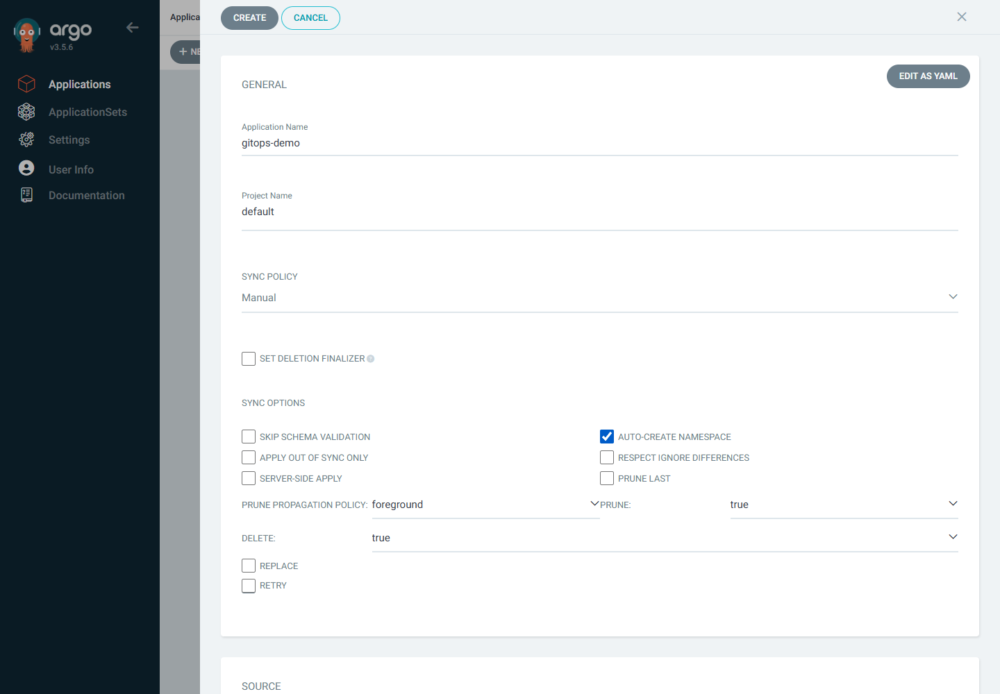
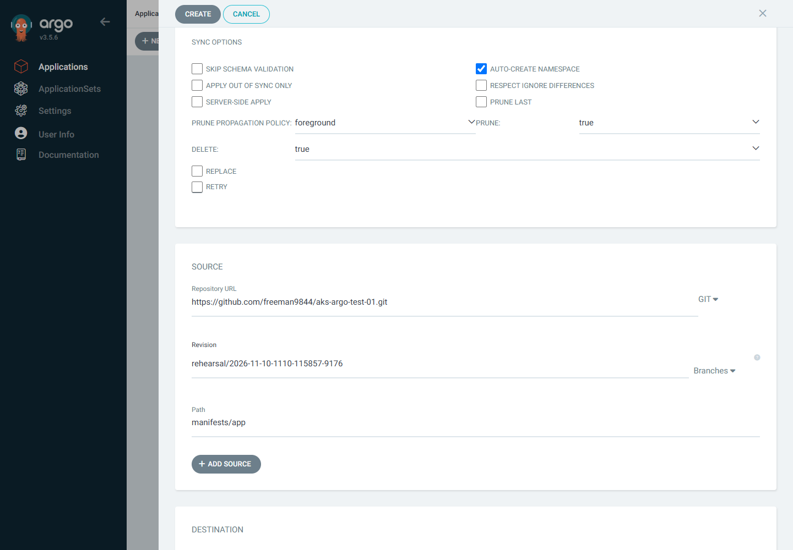
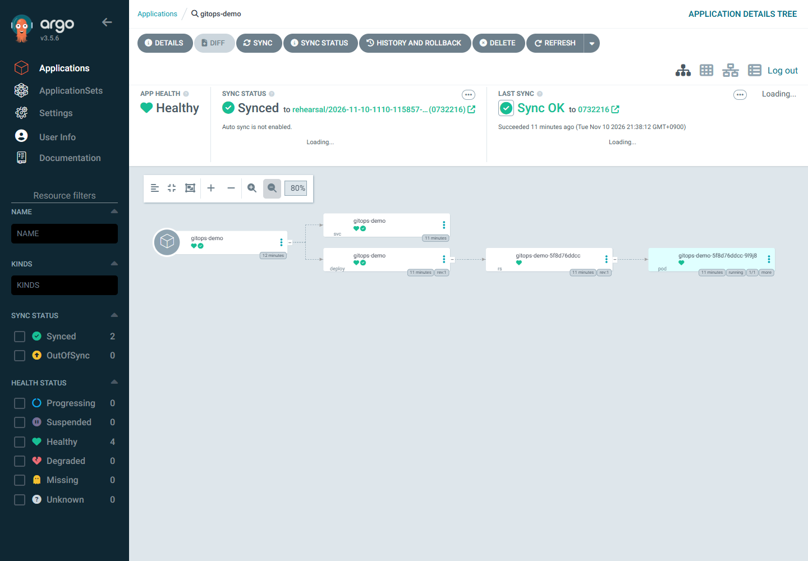

# 04. UI에서 샘플 앱 생성과 첫 배포

> 목표 시간 15분. UI에서 앱을 만들고 첫 수동 Sync·리소스 상태·HTTP 응답을 확인합니다. 첫 동기화·공개 IP 할당 대기를 포함합니다.

## 목표

UI에서 Application을 생성하고 첫 수동 Sync를 수행합니다. 자신의 Fork를 바라보는 앱이 `Synced`·`Healthy`, nginx replicas 1·Ready 1이며 브라우저에서 nginx 페이지가 열립니다.

## 0. UI와 입력값 준비

👁️ **설명**

03의 **PC PowerShell 창 A** 포트포워딩과 **https://127.0.0.1:8080** UI 로그인을 유지합니다. 끊겼다면 [03의 로컬 접속 절차](03-install-argocd-extension.md)로 재연결합니다.

입력할 저장소·브랜치는 기존 Cloud Shell에서 확인할 수 있습니다. 로그인 비밀번호와 무관한 값입니다.

🟢 **실행**

**실행 위치: Cloud Shell Bash / UI 입력값 확인용**

```bash
set -euo pipefail
source "$HOME/.aks-argocd-ws-env"
az account set --subscription "$SUBSCRIPTION_ID"
printf 'Git: %s / branch: %s\n' "$REPO_URL" "$GIT_BRANCH"
```

📋 **확인**

표시된 저장소가 자신의 공개 Fork이며 추적할 브랜치가 맞는지 GitHub 화면과 비교합니다.

## 1. UI에서 NEW APP

👁️ **설명**

GitHub에서 **자신의 공개 Fork**, 추적할 브랜치, `manifests/app/deployment.yaml`·`service.yaml`이 있는지 먼저 확인합니다. 비공개 저장소의 읽기 오류를 토큰 추가로 우회하지 않습니다.

🟢 **실행**

**실행 위치: PC 브라우저 / Argo CD UI**

Argo CD의 **Applications → + NEW APP**을 선택합니다. UI 레이블·배치는 설치 버전에 따라 다를 수 있지만 입력값의 의미는 같습니다.

| 구역 | 필드 | 입력 |
|---|---|---|
| General | Application Name | `gitops-demo` |
| General | Project Name | `default` |
| General | Sync Policy | **Manual** — 첫 배포를 직접 관찰 |
| Sync Options | Auto-Create Namespace | **선택** — `CreateNamespace=true` |
| Source | Repository URL | 자신의 공개 Fork URL. 예: `https://github.com/<내계정>/<Fork이름>.git` |
| Source | Revision | 01에서 확인한 실제 브랜치 이름 |
| Source | Path | `manifests/app` |
| Destination | Cluster URL 또는 이름 | `https://kubernetes.default.svc` 또는 `in-cluster` |
| Destination | Namespace | `workshop` |

Auto-Create Namespace가 보이지 않으면 Sync Options를 펼칩니다. 일반 YAML 디렉터리를 사용하므로 Helm Chart나 Kustomize 옵션을 추가하지 않습니다. 이 단계에서는 **자동 Sync·Prune·Self Heal을 아직 켜지 않습니다**.





위 화면은 리허설 전용 저장소·브랜치입니다. 자신의 Fork·실제 브랜치로 바꾸고 **아래로 스크롤해 Destination도 표대로 입력**합니다.

입력값을 다시 확인하고 **CREATE**를 선택합니다. 앱을 만들었지만 아직 첫 배포를 실행하지 않은 상태입니다. 처음에는 `OutOfSync`, 리소스가 없으면 `Missing` 등이 표시될 수 있습니다.

📋 **확인**

Applications에 `gitops-demo`가 생성됐고 저장소·브랜치·path·Destination과 **Manual** 정책이 입력한 값인지 확인합니다. 앱 생성과 실제 배포는 별도 단계입니다.

## 2. 첫 수동 Sync

👁️ **설명**

처음 한 번은 직접 Sync를 요청해 Git의 Deployment·Service가 클러스터에 생성되는 과정을 관찰합니다.

🟢 **실행**

**실행 위치: PC 브라우저 / Argo CD UI**

1. Applications에서 **gitops-demo**를 엽니다.
2. **SYNC → SYNCHRONIZE**를 선택합니다. 첫 배포에는 삭제할 기존 리소스가 없으므로 별도 Force·Replace·Prune 옵션을 켜지 않습니다.
3. Sync 작업 결과와 리소스 트리를 관찰합니다. Namespace 생성 옵션이 적용되어 `workshop`에 앱이 만들어집니다.
4. 작업 성공뿐 아니라 **Sync Status: Synced**, **Health Status: Healthy**를 모두 확인합니다.

📋 **확인**



상단 **APP HEALTH·SYNC STATUS**를 확인합니다. 왼쪽 필터에 `Healthy`·`Synced`라는 단어가 있다는 것만으로 성공을 판정하지 않습니다. 트리 오른쪽이 잘리면 **Zoom out**으로 축소합니다.

기본 5분을 기다려도 수렴하지 않으면 앱의 conditions·작업 메시지·events를 확인하고 다음 단계로 넘어가지 않습니다. 이미 UI에서 앱을 생성했으므로 참고 YAML을 별도로 적용해 중복 관리하지 않습니다.

Application 자체는 Argo CD가 실행되는 `argocd` namespace에 있습니다. **Destination Namespace는 앱 리소스가 배포되는 `workshop`**이며 둘을 혼동하지 않습니다.

## 3. 리소스 트리와 첫 revision 확인

👁️ **설명**

Deployment와 Service 이름은 모두 `gitops-demo`입니다. 리소스 종류와 `workshop` namespace를 확인해서 선택합니다.

아래는 트리의 구조 예시이며 실행 명령이 아닙니다.

```text
Application: gitops-demo
  Deployment: gitops-demo → ReplicaSet → Pod 1개
  Service: gitops-demo
```

🟢 **실행**

**실행 위치: PC 브라우저 / Argo CD UI**

트리의 **deploy** 노드가 Deployment, **svc** 노드가 Service입니다. Deployment 상세의 **LIVE MANIFEST**에서 `spec.replicas: 1`, 아래쪽 `status.readyReplicas: 1`을 확인합니다. 코드 영역 안에서 끝까지 스크롤하거나 포커스를 두고 **Ctrl+End**를 누릅니다. 트리에 Pod가 하나 보이는 것만으로 Ready라고 판정하지 않습니다. Pod 상세에서 Ready 상태·events·logs도 볼 수 있습니다.

Application의 revision을 선택해 커밋 상세 또는 연결된 GitHub 커밋을 확인합니다. UI가 축약 SHA만 보여 주면 전체 커밋 상세로 이동해 자신의 Fork·브랜치의 커밋인지 비교합니다. 과거 이력을 뜻하는 History와 현재 반영 상태를 혼동하지 않습니다.

📋 **확인**

현재 revision이 자신의 Fork·브랜치와 일치하고 live replicas·Ready가 모두 1이어야 합니다.

## 4. UI에서 Service IP를 찾아 브라우저로 확인

👁️ **설명**

트리의 **Service / gitops-demo / workshop**을 열고 LIVE MANIFEST의 다음 상태를 찾습니다.

아래 YAML과 IP는 위치를 보여 주는 예시이며 터미널에 입력하지 않습니다.

```yaml
status:
  loadBalancer:
    ingress:
      - ip: 203.0.113.10
```

🟢 **실행**

**실행 위치: PC 브라우저 / Argo CD UI → 샘플 앱**

실제 표시된 IP로 **http://실제-IP**를 열어 nginx 기본 페이지를 확인합니다. UI에 IP가 없으면 REFRESH 후 다시 확인하고, 약 5분 이상 할당되지 않으면 Service events와 Azure 네트워크 상태를 진단합니다.

📋 **확인**

nginx 기본 페이지가 열려야 합니다. HTTP 200을 엄밀히 확인하려면 브라우저 개발자 도구의 Network에서 문서 요청 상태를 확인합니다.

⚠️ **주의**

관리 화면은 **로컬 HTTPS**, 샘플 앱은 **공개 HTTP**입니다. 앱에는 비밀·개인정보를 넣지 않습니다.

## 참고 YAML과 진단

👁️ **설명**

[Application YAML](../manifests/argocd/application.yaml)은 **05에서 자동 정책을 켠 후의 참고 상태**입니다. 이 모듈의 첫 Manual 설정과는 다릅니다. `__REPO_URL__`·`__GIT_BRANCH__`는 참고용 자리표시자이며 UI에는 실제 값을 입력합니다. 기본 실습에서는 이 YAML을 kubectl로 적용하지 않습니다.

UI에서 상태를 읽기 어려울 때만 다음 CLI를 진단에 사용합니다. 앱 Deployment·Service를 직접 적용하는 우회 방법이 아닙니다.

🟢 **실행**

**실행 위치: Cloud Shell Bash / 문제 해결용으로만**

```bash
set -euo pipefail
source "$HOME/.aks-argocd-ws-env"
az account set --subscription "$SUBSCRIPTION_ID"
kubectl config use-context "$CLUSTER"
kubectl describe application "$APP_NAME" -n argocd
kubectl get deployments,pods,services -n "$APP_NAMESPACE"
```

📋 **확인**

Application의 conditions·작업 메시지와 Pod·Service 상태에서 실패 원인을 찾습니다. 진단 명령을 실행했다는 이유만으로 배포 성공으로 판단하지 않습니다.

## 트러블슈팅

| 증상 | 확인과 대응 |
|---|---|
| `ComparisonError`·`SyncError` | `kubectl describe application gitops-demo -n argocd`에서 repoURL·targetRevision·path와 오류 확인 |
| 브랜치를 바꿨는데 반영 안 됨 | Application의 targetRevision과 GitHub 편집 브랜치가 동일한지 확인 |
| namespace 없음·Sync 실패 | Auto-Create Namespace 옵션과 Destination Namespace가 `workshop`인지 확인 |
| `ImagePullBackOff` | nginx 공개 이미지 송신·Docker Hub rate limit 확인. 사용 태그는 `nginx:1.28.3` |
| `Healthy`가 되지 않음 | Pod events·probes·resource requests 확인. sync 성공만으로 앱 정상 판정하지 않음 |
| IP는 있으나 HTTP 실패 | Service events·Pod Ready·EndpointSlice·네트워크 정책 확인 후 요청 재시도 |
| 브라우저 `ERR_BLOCKED_BY_CLIENT` | 브라우저·조직의 접근 제한과 앱 장애를 구분. 보안 정책을 해제하지 말고 승인된 HTTP 클라이언트의 응답과 함께 확인. 브라우저 확인을 대체 완료로 기록하지 않음 |

참고: [공식 UI 앱 생성·Sync](https://argo-cd.readthedocs.io/en/stable/getting_started/#creating-apps-via-ui). extension 1.0.20 / UI v3.5.6에서 NEW APP·첫 Sync·live replicas·Ready·Service IP를 실제 확인했습니다. HTTP 200은 PowerShell 클라이언트로 확인했으며, Edge의 nginx 페이지 탐색은 차단돼 미검증입니다. [전체 검증 범위](../README.md#검증-범위와-대체-단계)를 확인합니다.

## 완료 체크

- [ ] UI에서 자신의 공개 Fork를 읽는 Manual Application을 만들었습니다.
- [ ] 첫 Sync 후 상단 APP HEALTH·SYNC STATUS가 Healthy·Synced입니다.
- [ ] 현재 Git revision과 live replicas 1·Ready 1을 확인했습니다.
- [ ] 실제 Service IP로 nginx 페이지와 HTTP 응답을 확인했습니다.

## 다음 단계

[← 03. extension 설치·UI 접속](03-install-argocd-extension.md) | [README](../README.md) | [다음: 05. Git 변경·자동 복구 →](05-gitops-update-self-heal.md)
