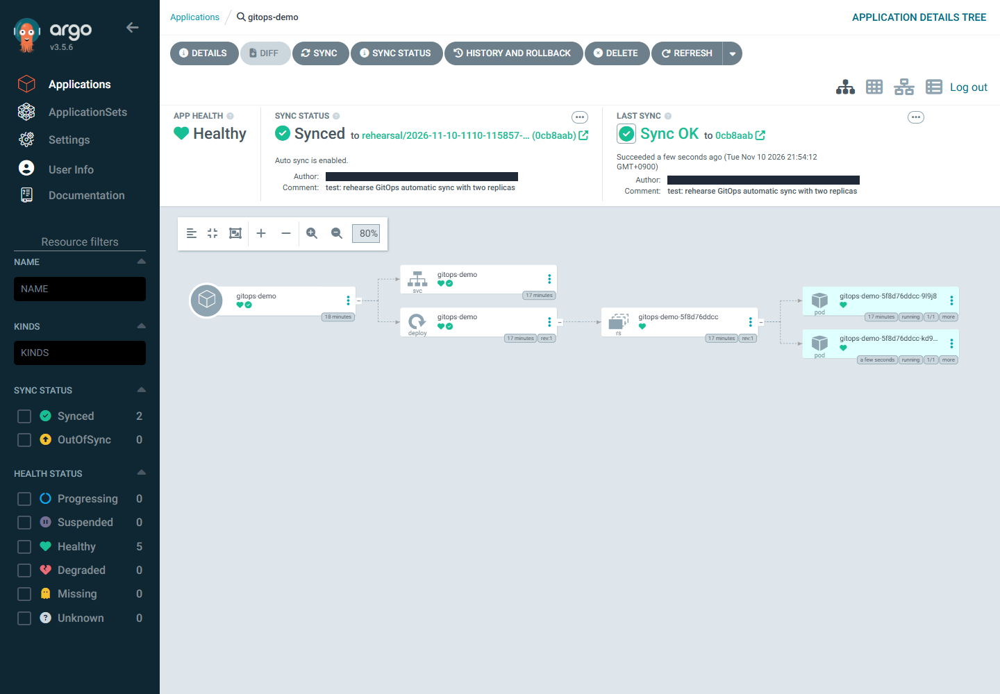

# 05 — Git 변경 반영과 자동 복구

> **실행**: 직접 입력합니다. **개념**: 읽기만 합니다. **예상 출력**: 비교용입니다.

예상 소요 시간: 20분.

## 성공 조건

UI에서 자동 Sync·Prune·Self Heal을 활성화합니다. GitHub 웹 커밋의 SHA와 replicas·Ready 수 2를 UI에서 확인하고, 수동 변경 3이 Git 추가 커밋 없이 2로 복귀하는 것을 관찰합니다.

## 0. UI 준비

PC의 포트포워딩과 **https://127.0.0.1:8080** UI 로그인을 유지합니다. 04의 수동 첫 배포가 `Synced`·`Healthy`, replicas·Ready 1인 상태에서 `gitops-demo`를 엽니다.

## 1. UI에서 자동 동기화 활성화

Application의 **DETAILS → Sync Policy**에서 **ENABLE AUTO-SYNC** 또는 해당 버전의 편집 동작을 선택합니다. 다음 정책을 설정·저장하고 다시 화면에서 확인합니다.

| 정책 | 설정 | 의미 |
|---|---|---|
| Automated Sync | 활성화 | Git 변경을 자동 반영 |
| Prune Resources 또는 Auto-Prune | 활성화 | Git에서 제거한 관리 리소스의 자동 삭제 |
| Self Heal | 활성화 | 클러스터의 수동 변경을 Git 상태로 복구 |

리허설의 UI v3.5.6에서는 다음 순서였습니다. **각 확인창의 OK를 누른 뒤 체크 상태가 실제 반영될 때까지 기다리고** 다음 항목으로 넘어갑니다. 빠르게 연속 변경하면 앞선 설정이 유지되지 않을 수 있으므로 마지막에 세 항목을 다시 확인합니다.

1. **ENABLE AUTO-SYNC** 선택 → **Enable Auto-Sync? → OK**.
2. 나타난 **PRUNE RESOURCES** 선택 → **Enable Prune Resources? → OK**.
3. 아래쪽 **SELF HEAL** 선택 → **Enable Self Heal? → OK**.

항목이 화면 아래에 있으면 DETAILS 패널을 더 스크롤합니다. **Auto-Create Namespace는 그대로 유지**합니다. 자동 Sync만 켜고 Self Heal을 빠뜨리면 뒤의 복구 실습은 동작하지 않습니다.

Prune은 삭제 권한을 가진 설정입니다. 실습 중 Git에서 앱 파일을 지우지 않으며 Allow Empty·Force·Replace 등의 추가 옵션은 켜지 않습니다.

## 2. GitHub 웹에서 replicas 변경


자신의 Fork에서 Application이 추적하는 브랜치를 선택합니다. `manifests/app/deployment.yaml`을 열고 연필 아이콘으로 다음 한 줄만 변경합니다.

**개념 — 편집 후 값**
```yaml
spec:
  replicas: 2
```

**Commit changes**를 선택하고 **현재 브랜치에 직접 커밋**합니다. PR이나 다른 브랜치로만 커밋하면 현재 Application은 변경을 읽지 못합니다. 커밋 화면에서 **전체 SHA**를 복사합니다.

## 3. UI에서 새 revision과 실제 배포 확인

Git 폴링은 즉시 실행을 보장하지 않습니다. 기본 폴링은 통상 약 3분 이내 주기로 동작하지만 설치 설정·부하에 따라 달라집니다. UI를 보며 약 5분을 기다리고, 수렴하지 않으면 오류를 진단합니다.

1. Application의 현재 반영 revision을 확인합니다. 축약 SHA면 커밋 상세·GitHub 링크에서 전체 SHA를 열어 방금 만든 커밋과 비교합니다.
2. **Synced와 Healthy를 모두** 확인합니다. History에 커밋이 보인다는 이유만으로 현재 배포 성공이라고 판단하지 않습니다.
3. 트리의 **Deployment / gitops-demo / workshop**을 열고 LIVE MANIFEST에서 `spec.replicas: 2`, `status.readyReplicas: 2`를 확인합니다.
4. Pod 2개가 Ready인지 확인합니다. 롤아웃 중 이전 Pod가 잠시 더 보일 수 있으므로 최종 상태로 수렴할 때까지 기다립니다.

**개념 — 성공 상태**
```text
현재 반영 revision = GitHub에서 커밋한 SHA
Sync = Synced / Health = Healthy
Deployment replicas = 2 / readyReplicas = 2
```

페이지는 같은 nginx 페이지입니다. 바뀐 것은 replicas이며 이번 단계는 페이지 내용 변경 실습이 아닙니다.



리허설에서는 EMU의 공개 Fork 제한으로 승인된 격리 브랜치·`gh` 커밋을 사용했습니다. **위 화면의 브랜치를 복사하지 말고 자신의 Fork·추적 브랜치**에서 편집합니다. GitHub 웹 편집 자체는 미검증입니다.

### 지연될 때의 진단

UI의 **REFRESH**로 Git 상태 비교를 요청할 수 있습니다. REFRESH는 앱을 수동 배포하는 SYNC와 다릅니다. 먼저 repoURL·브랜치·path·자동 정책·conditions를 확인하고, 수동 SYNC로 자동 동기화 문제를 숨기지 않습니다.

다음 CLI는 UI 메시지로 원인을 찾기 어려울 때만 사용합니다.

**실행 — Cloud Shell Bash, 문제 해결용**
```bash
set -euo pipefail
source "$HOME/.aks-argocd-ws-env"
az account set --subscription "$SUBSCRIPTION_ID"
kubectl config use-context "$CLUSTER"
kubectl describe application "$APP_NAME" -n argocd
kubectl get deployments,pods -n "$APP_NAMESPACE"
```

## 4. 수동 변경을 만들고 UI에서 self-heal 관찰

**개념**: Git이 원하는 값 2입니다. 사람이 kubectl로 3으로 바꾸면 `selfHeal: true`인 Argo CD가 차이를 감지해 2로 되돌립니다. Pod 3개가 모두 Ready가 되기 전에 복구될 수도 있습니다.

UI에서 현재 revision을 기록하고 Deployment의 live 상태와 리소스 트리를 열어 둡니다. 포워딩 중인 PC 창 A는 그대로 유지하고 **Cloud Shell Bash**에서 다음을 한 번 실행합니다.

**실행 — Cloud Shell Bash, 의도적인 drift 생성 1회**
```bash
set -euo pipefail
source "$HOME/.aks-argocd-ws-env"
az account set --subscription "$SUBSCRIPTION_ID"
az aks get-credentials --resource-group "$RESOURCE_GROUP" --name "$CLUSTER" \
  --context "$CLUSTER"
kubectl config use-context "$CLUSTER"
kubectl scale deployment "$APP_NAME" -n "$APP_NAMESPACE" --replicas=3
```

`deployment.apps/gitops-demo scaled`를 확인한 뒤 UI로 돌아옵니다. App·리소스 상태가 잠시 OutOfSync·진행 중으로 보일 수 있으며, **Git 추가 커밋 없이** `spec.replicas: 2`와 `status.readyReplicas: 2`, `Synced`·`Healthy`로 복귀하는지 약 3분 내 확인합니다. Application revision도 변경 전과 같아야 합니다.

복구가 빨라 UI에서 순간 값 3이나 세 번째 Pod를 놓칠 수 있습니다. CLI scale 성공, 최종 live 상태 2·Ready 2, 동일 revision과 GitHub 파일의 replicas 2를 함께 확인합니다. 화면을 캡처하려고 Self Heal을 끄거나 수동 SYNC로 결과를 만들지 않습니다.


## 문제 해결

| 증상 | 확인과 대응 |
|---|---|
| 새 SHA로 갱신 안 됨 | 다른 브랜치·다른 Fork·PR에만 커밋하지 않았는지 확인 |
| SHA는 새 값이지만 replicas 1 | sync 오류·실제 Git 파일·추적 path 확인. revision만으로 성공 판정하지 않음 |
| 3에서 복귀하지 않음 | Application의 자동 동기화·selfHeal·controller 상태 확인 |
| Ready 수가 2가 아님 | `kubectl describe deployment`와 Pod events 확인. HPA를 추가하지 않음 |

참고: [Argo CD Automated Sync Policy](https://argo-cd.readthedocs.io/en/stable/user-guide/auto_sync/). 실제 리허설에서 새 SHA 자동 반영·replicas·Ready 2, scale 3을 1회 실행한 뒤 동일 SHA의 2로 복귀를 검증했습니다. Prune은 활성화만 확인했고 Git 파일 삭제 실험은 하지 않았습니다. [검증 범위](../README.md#검증-범위와-대체-단계)를 확인합니다.

[← 04 — 앱 배포](04-deploy-sample-app.md) | [다음: 06 — 정리](06-cleanup.md)
