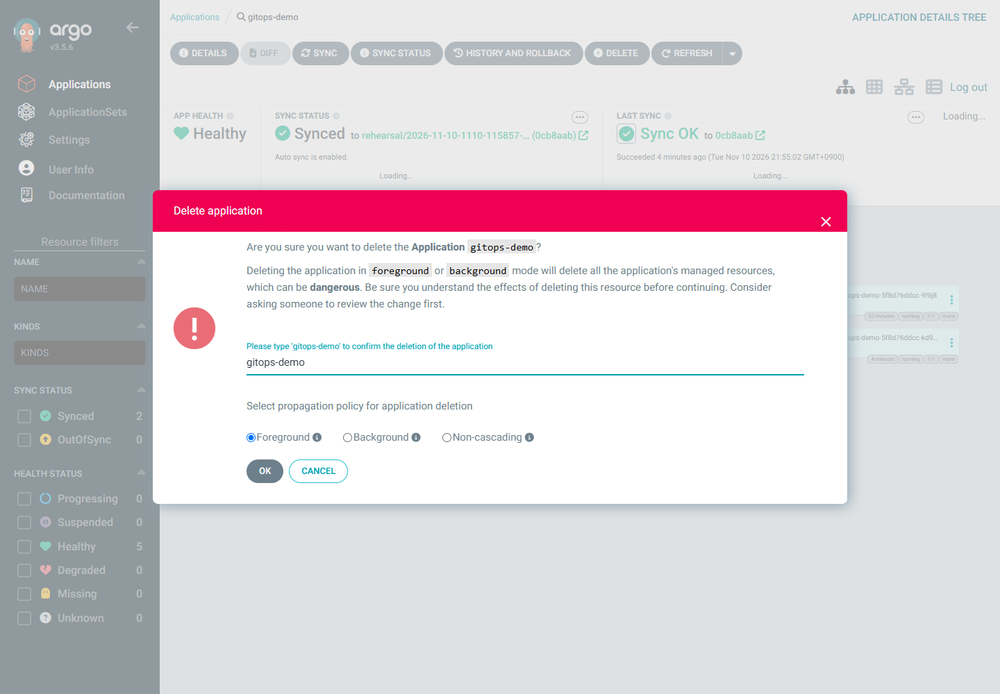
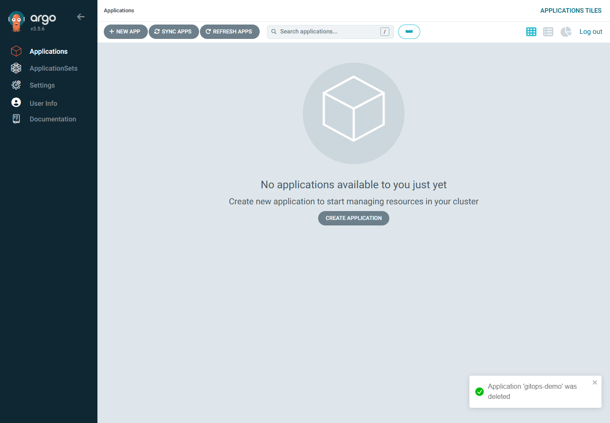

# 06. 정리

> 목표 시간 10분. UI에서 앱을 삭제하고 Azure 두 그룹과 로컬 설정을 정리합니다. Azure 삭제 대기는 더 길어질 수 있으며, 삭제 요청 접수만으로 완료라고 보지 않습니다.

## 목표

실습 리소스 그룹과 AKS 관리 노드 리소스 그룹이 모두 없어지고 해당 실습의 로컬 설정만 정리됩니다.

⚠️ **주의**

이 모듈은 실습 전용 리소스 그룹의 모든 리소스를 삭제합니다. 기존 서비스가 들어 있는 그룹에 실행하지 마세요. GitHub Fork 삭제는 별개입니다.

## 1. 삭제 대상 확인 — 정상·중도 종료 공통

👁️ **설명**

원래 환경 파일로 구독·리소스 이름을 복원합니다. 그룹의 소유 태그와 실제 리소스를 확인하고 삭제할 이름을 다시 입력합니다.

🟢 **실행**

**실행 위치: Cloud Shell Bash**

```bash
set -euo pipefail
source "$HOME/.aks-argocd-ws-env"
az account set --subscription "$SUBSCRIPTION_ID"
az account show --query '{Name:name,State:state}' -o table
az group show --name "$RESOURCE_GROUP" --query '{Name:name,Tags:tags}' -o json
az resource list --resource-group "$RESOURCE_GROUP" --query '[].{Name:name,Type:type}' -o table
test "$(az group show -n "$RESOURCE_GROUP" --query tags.workload -o tsv)" = aks-argocd-workshop
test "$(az group show -n "$RESOURCE_GROUP" --query tags.environment -o tsv)" = workshop
read -r -p "삭제할 실습 리소스 그룹 이름을 다시 입력: " CONFIRM_GROUP
if [ "$CONFIRM_GROUP" != "$RESOURCE_GROUP" ]; then
  echo "이름이 일치하지 않습니다. 삭제를 중단합니다." >&2
  exit 1
fi
```

📋 **확인**

구독·그룹 이름이 이번 실습과 같고 `workload=aks-argocd-workshop`, `environment=workshop` 태그가 있어야 합니다.

⚠️ **주의**

환경 파일이 없다면 [01의 복구 절차](01-prerequisites.md#5-새-세션에서-재개하는-경우)를 사용합니다. 그룹이 이미 없다면 삭제를 다시 실행하지 말고 기록한 노드 그룹의 부재를 확인한 후 5절로 이동합니다.

## 2. 노드 리소스 그룹 이름 확인

👁️ **설명**

AKS 생성에 성공했다면 환경 파일에 기록되어 있습니다. 생성 중 중단했다면 그룹 안에 AKS 리소스가 있는지 먼저 확인합니다.

🟢 **실행**

**실행 위치: Cloud Shell Bash**

```bash
CLUSTER_ID="$(az resource list -g "$RESOURCE_GROUP" \
  --resource-type Microsoft.ContainerService/managedClusters \
  --query "[?name=='$CLUSTER'].id | [0]" -o tsv)"
if [ -n "$CLUSTER_ID" ]; then
  NODE_RESOURCE_GROUP="$(az aks show -g "$RESOURCE_GROUP" -n "$CLUSTER" --query nodeResourceGroup -o tsv)"
  test -n "$NODE_RESOURCE_GROUP"
  export NODE_RESOURCE_GROUP
  printf 'export NODE_RESOURCE_GROUP=%q\n' "$NODE_RESOURCE_GROUP" >> "$HOME/.aks-argocd-ws-env"
fi
printf '실습 그룹: %s / 노드 그룹: %s\n' "$RESOURCE_GROUP" "${NODE_RESOURCE_GROUP:-미생성 또는 미확인}"
```

📋 **확인**

실습 그룹과 실제 관리 노드 그룹 이름을 구분합니다. AKS가 전혀 생성되지 않았다면 노드 그룹도 없을 수 있습니다. 생성 실패·삭제 중인 AKS에 노드 그룹이 남았는지 불명확하면 portal의 활동 로그·리소스 목록으로 확인합니다. 이름을 추측해 삭제하지 않습니다.

## 3. UI에서 앱 삭제 — controller가 동작하는 경우

👁️ **설명**

앱은 Git에서 관리되므로 Deployment·Service만 수동 삭제하면 다시 생성될 수 있습니다. 먼저 Application과 자식 리소스를 함께 삭제합니다. **controller와 PC 포트포워딩을 아직 종료하지 않습니다.**

### 3.1. Argo CD UI에서 cascading deletion

🟢 **실행**

**실행 위치: PC 브라우저 / Argo CD UI**

1. PC 브라우저의 **https://127.0.0.1:8080 → Applications**에서 **gitops-demo**를 선택합니다.
2. 저장소·Destination이 자신의 Fork와 `workshop`인지 확인한 뒤 **DELETE**를 선택합니다. 다른 앱이나 트리의 Pod만 삭제하지 않습니다.
3. 삭제 대화상자에서 **Foreground / Cascading**을 선택합니다. 버전에 따라 Cascade 체크박스와 propagation policy 선택으로 나뉠 수 있습니다.
4. **Non-Cascading / Orphan은 선택하지 않습니다.** 이 옵션은 앱만 삭제하고 Deployment·Service를 남깁니다.
5. 확인란에 앱 이름을 입력하고 삭제를 요청합니다. 자식 리소스 정리가 끝나 Application이 목록에서 사라질 때까지 기다립니다.



📋 **확인**

리허설의 UI v3.5.6에서는 **Foreground** 라디오 버튼을 선택하고 `gitops-demo`를 입력한 뒤 **OK**로 확정했습니다.

Foreground는 자식 정리를 기다린 후 앱을 제거합니다. 기본 5분 내 완료되지 않으면 controller·Service events와 삭제 오류를 확인하고, extension을 먼저 제거하지 않습니다.



빈 목록만으로 자식 리소스 삭제까지 단정하지 않고 아래 CLI로 부재를 함께 확인합니다.

<details>
<summary>UI 접속이 불가능할 때만: Cloud Shell의 앱 삭제 대안</summary>

⚠️ **주의**

아직 Application 삭제를 요청하지 않았고 controller가 동작할 때만 사용합니다. UI에서 이미 삭제했다면 중복 실행하지 않습니다. finalizer가 없는 UI 생성 앱에는 foreground 정리용 finalizer를 추가합니다. 예상 밖의 finalizer가 있으면 무조건 덮어쓰지 않고 중단합니다.

🟢 **실행**

**실행 위치: Cloud Shell Bash / UI 불가 시에만**

```bash
kubectl config use-context "$CLUSTER"
finalizers="$(kubectl get application "$APP_NAME" -n argocd -o jsonpath='{.metadata.finalizers[*]}')"
if [ -z "$finalizers" ]; then
  kubectl patch application "$APP_NAME" -n argocd --type=merge \
    -p '{"metadata":{"finalizers":["resources-finalizer.argocd.argoproj.io"]}}'
elif [ "$finalizers" != resources-finalizer.argocd.argoproj.io ]; then
  printf '예상 밖의 finalizer입니다. 확인 후 진행하세요: %s\n' "$finalizers" >&2
  exit 1
fi
kubectl delete application "$APP_NAME" -n argocd --wait=true --timeout=300s
```

📋 **확인**

삭제가 완료됐다면 아래 3.2절에서 자식 리소스 부재를 함께 확인합니다. 이미 Terminating이거나 controller가 없다면 finalizer를 강제로 제거하지 않고 아래 중도 종료 경로를 사용합니다.

</details>

### 3.2. Cloud Shell에서 자식 리소스 제거 확인

👁️ **설명**

UI에서 앱이 사라졌다는 것만으로 정리를 끝내지 않고 실제 Application·Deployment·Service가 남았는지 조회합니다.

🟢 **실행**

**실행 위치: Cloud Shell Bash / UI·대안 삭제 후 공통**

```bash
kubectl config use-context "$CLUSTER"
remaining_app="$(kubectl get application "$APP_NAME" -n argocd --ignore-not-found -o name)"
if [ -n "$remaining_app" ]; then
  echo "Application이 아직 남아 있습니다. 삭제 오류를 확인하세요." >&2
  exit 1
fi
remaining="$(kubectl get deployments,services -n "$APP_NAMESPACE" -o name)"
if [ -n "$remaining" ]; then
  printf '앱 리소스가 남아 있습니다:\n%s\n' "$remaining" >&2
  exit 1
fi
```

📋 **확인**

남은 Application·앱 리소스가 없고 블록이 오류 없이 끝나야 합니다. 오류가 있다면 extension을 먼저 제거하지 않습니다.

### 3.3. 포트포워딩 중단 후 namespace·extension 정리

🟢 **실행**

**실행 위치: 참가자 PC / PowerShell 창 A**

PC의 **PowerShell 창 A에서 Ctrl+C**로 이 실습의 포트포워딩을 중단합니다. 의도적인 중단 뒤 표시되는 종료 오류는 03의 안내대로 처리합니다. 브라우저의 로컬 UI 탭도 닫습니다.

🟢 **실행**

**실행 위치: Cloud Shell Bash**

```bash
kubectl delete namespace "$APP_NAMESPACE" --wait=true --timeout=180s
az k8s-extension delete --resource-group "$RESOURCE_GROUP" \
  --cluster-name "$CLUSTER" --cluster-type managedClusters --name "$EXTENSION_NAME" --yes
```

📋 **확인**

namespace 삭제와 extension 삭제 명령이 오류 없이 완료돼야 합니다.

### 중도 종료 경로

⚠️ **주의**

AKS 생성 실패, extension 설치 실패, Application 미생성, controller가 이미 제거되어 finalizer가 멈춘 경우에는 **3절을 건너뛰고** 1~2절의 삭제 대상 확인 후 4절로 이동합니다. 클러스터 내부 정리가 불가능해도 전용 Azure 그룹 삭제로 AKS와 관리 노드 리소스를 정리할 수 있습니다.

finalizer를 무조건 강제 제거하거나 노드 그룹·공인 IP를 개별적으로 먼저 삭제하지 않습니다.

## 4. 전용 그룹 삭제 및 완료 대기

👁️ **설명**

1절에서 확인한 전용 그룹만 삭제합니다.

🟢 **실행**

**실행 위치: Cloud Shell Bash**

```bash
az group delete --name "$RESOURCE_GROUP" --yes --no-wait
for attempt in $(seq 1 120); do
  GROUP_EXISTS="$(az group exists --name "$RESOURCE_GROUP")"
  if [ "$GROUP_EXISTS" = false ]; then break; fi
  sleep 10
done
if [ "$GROUP_EXISTS" != false ]; then
  echo "20분 내 그룹 삭제가 완료되지 않았습니다. portal의 삭제 오류를 확인하세요." >&2
  exit 1
fi
if [ -n "${NODE_RESOURCE_GROUP:-}" ]; then
  for attempt in $(seq 1 60); do
    NODE_GROUP_EXISTS="$(az group exists --name "$NODE_RESOURCE_GROUP")"
    if [ "$NODE_GROUP_EXISTS" = false ]; then break; fi
    sleep 10
  done
  if [ "$NODE_GROUP_EXISTS" != false ]; then
    echo "AKS 노드 그룹이 아직 남아 있습니다. 비용과 AKS 삭제 오류를 확인하세요." >&2
    exit 1
  fi
else
  echo "노드 그룹 이름이 없습니다. AKS 생성 이력과 잔여 노드 리소스를 확인한 뒤 완료로 판정하세요." >&2
  exit 1
fi
```

📋 **확인**

실습 그룹과 기록된 관리 노드 그룹 모두 `az group exists` 결과가 `false`여야 합니다.

⚠️ **주의**

조회 권한 오류는 `false`로 간주하지 않습니다. 삭제 중인 리소스·오류·잠금은 portal에서 확인하고 해결합니다. 노드 그룹이 남았거나 그 상태를 확인하지 못했다면 정리 완료가 아닙니다.

## 5. 해당 실습의 로컬 흔적

👁️ **설명**

Azure 정리 완료 후 이번 실습의 컨텍스트·환경 파일만 제거합니다. Cloud Shell과 PC에 있는 설정은 별도로 확인합니다.

🟢 **실행**

**실행 위치: Cloud Shell Bash / Azure 삭제 완료 확인 후**

```bash
kubectl config get-contexts
```

📋 **확인**

목록에서 이 실습의 `$CLUSTER` 컨텍스트만 확인한 뒤 삭제합니다.

🟢 **실행**

**실행 위치: Cloud Shell Bash**

```bash
kubectl config delete-context "$CLUSTER"
```

📋 **확인**

선택한 실습 컨텍스트의 삭제 메시지를 확인합니다.

⚠️ **주의**

kubeconfig의 사용자·클러스터 항목은 다른 컨텍스트가 참조할 수 있으므로 일괄 삭제하지 않습니다. 필요하면 `kubectl config view`에서 참조 관계를 확인한 후 이 실습 전용 항목만 수동 제거합니다. kubeconfig 내용에는 자격 증명이 있을 수 있으므로 공유하지 마세요.

로컬 PC에도 별도 kubeconfig가 있습니다. 포워딩 종료 후 창 B 또는 새 PowerShell에서 동일한 실습 이름을 확인하고 **해당 컨텍스트만** 제거합니다.

🟢 **실행**

**실행 위치: 참가자 PC / Windows PowerShell**

```powershell
$ErrorActionPreference = 'Stop'
$Cluster = Read-Host '삭제 완료한 실습 AKS 이름'
if ([string]::IsNullOrWhiteSpace($Cluster)) { throw '실습 AKS 이름이 필요합니다.' }
kubectl config get-contexts
if ($LASTEXITCODE -ne 0) { throw '로컬 컨텍스트 목록 조회에 실패했습니다.' }
$contexts = @(kubectl config get-contexts -o name)
if ($LASTEXITCODE -ne 0) { throw '로컬 컨텍스트 이름 조회에 실패했습니다.' }
if ($contexts -contains $Cluster) {
    kubectl config delete-context $Cluster
    if ($LASTEXITCODE -ne 0) { throw '실습 로컬 컨텍스트 삭제에 실패했습니다.' }
} else {
    Write-Host '해당 실습 컨텍스트가 이미 없습니다.'
}
Set-Clipboard -Value ''
```

📋 **확인**

이 실습의 PC 컨텍스트가 삭제됐거나 이미 없다는 메시지를 확인합니다. PC의 다른 컨텍스트·공유 사용자·클러스터 항목은 삭제하지 않습니다. 자격 증명이 포함될 수 있는 kubeconfig를 Git이나 메시지에 붙여넣지 않습니다.

기본 UI 경로에서는 Application 임시 파일을 만들지 않습니다. 이전 CLI 버전에서 만들었다면 해당 실습 이름의 두 파일만 제거합니다.

🟢 **실행**

**실행 위치: Cloud Shell Bash / 이전 CLI 버전 사용자만**

```bash
rm -f -- "$HOME/$CLUSTER-application.template.yaml" "$HOME/$CLUSTER-application.yaml"
```

🟢 **실행**

**실행 위치: Cloud Shell Bash / 환경 파일 정리**

```bash
rm -- "$HOME/.aks-argocd-ws-env"
```

📋 **확인**

이번 실습의 임시 파일·환경 파일만 정리됐는지 확인합니다.

GitHub Fork는 남겨도 Azure 요금이 발생하지 않습니다. 삭제하려면 자신의 Fork의 **Settings → General → Danger Zone → Delete this repository**에서 대상 소유자·이름을 재확인하세요.

## 트러블슈팅

| 증상 | 확인과 대응 |
|---|---|
| Application `Terminating` | controller가 실행 중인지 확인. 이미 제거됐다면 전용 Azure 그룹 전체 삭제 경로 사용 |
| 앱은 사라졌지만 Service·Deployment가 남음 | Orphan 삭제 여부 확인. 정리 완료로 보지 말고 전용 그룹 전체 삭제 경로로 이동 |
| 리소스 그룹 삭제 거부 | 리소스 잠금·권한·정책 확인. 임의로 조직 보안 설정을 해제하지 않음 |
| 노드 그룹·LB·IP 잔존 | AKS 삭제 상태와 활동 로그 확인. 비용 위험을 알리고 해결 전에는 완료로 기록하지 않음 |
| kubeconfig 컨텍스트 없음 | AKS 생성 전에 중단했거나 이미 정리했는지 확인. 다른 컨텍스트 삭제로 대체하지 않음 |

2026-11-10 실제 리허설에서는 UI foreground 삭제와 자식 부재 확인 후 전용 namespace·extension을 제거하고, 실습 그룹·기록된 관리 노드 그룹 모두 `az group exists=false`를 확인했습니다. namespace·extension·Azure 그룹 정리에 10분 36초가 걸렸습니다. 전용 로컬 자격 증명과 브라우저 세션도 제거했으며 공유 kubeconfig·기존 리소스는 삭제하지 않았습니다.

## 완료 체크

- [ ] 정상·중도 종료 상태에 맞는 삭제 경로를 선택했습니다.
- [ ] 실습 리소스 그룹의 부재를 확인했습니다.
- [ ] 기록된 AKS 관리 노드 그룹의 부재를 확인했습니다.
- [ ] 포워딩을 종료하고 이번 실습의 로컬 컨텍스트·환경 파일만 정리했습니다.
- [ ] 공유 리소스와 다른 컨텍스트는 삭제하지 않았습니다.

## 다음 단계

[← 05. Git 변경·자동 복구](05-gitops-update-self-heal.md) | [README로 돌아가기](../README.md)
